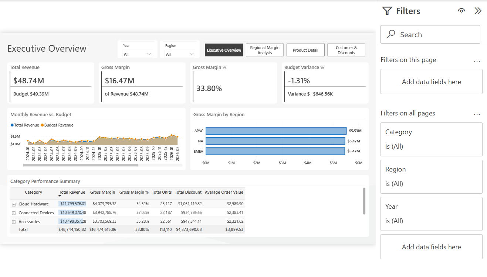
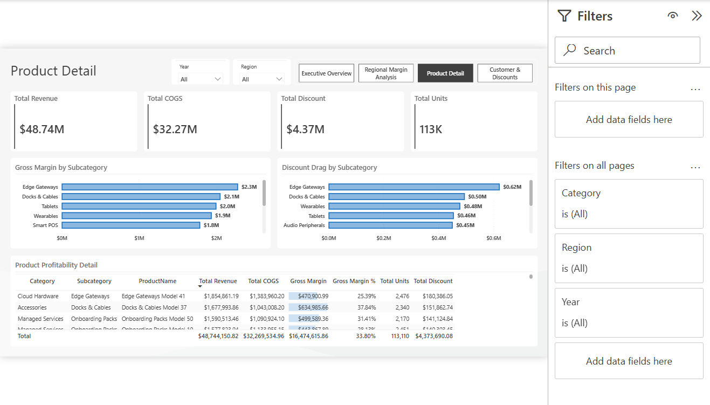
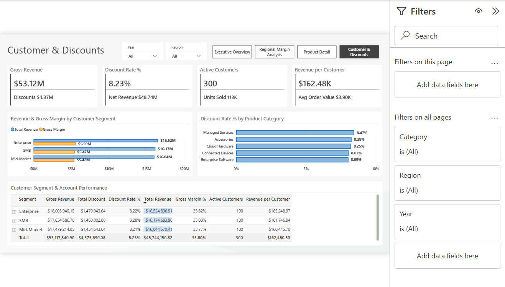

# Autonomous BI Engineering Agent System

A verification-first Autonomous BI Engineering Agent system for Power BI (`PBIP` / `TMDL` / `PBIR`). Given a structured business requirement (`requirements/*.yaml`), it validates the Kimball star-schema contract, authors or updates the semantic model and DAX/RLS definitions through a strict tool cascade, builds PBIR report pages exclusively via the `pbir` CLI, verifies every layer empirically across **7 deterministic gates (`G1`–`G7`)**, and permits commits only when a fresh `VerificationEvidenceBundle` matches the staged Git index tree SHA.

## Architecture

```text
requirements/REQ-*.yaml
        │
        ▼
workflows/bi_delivery (audit | deliver)
   ├─► Gate G1: Pydantic Design Contract
   ├─► Semantic Model Cascade:
   │      powerbi-modeling-mcp ─► TabularEditor.exe ─► PowerShell TOM/ADOMD ─► .tmdl (last resort)
   ├─► PBIR Report Authoring:
   │      pbir CLI exclusively (PreToolUse hook blocks direct *.Report/definition/**/*.json writes)
   ├─► Parallel Specialist Auditors (Model & DAX Hygiene + Report & Governance)
   └─► 7-Gate Verification Harness (`bi-agent verify-all`)
          └─► artifacts/runs/<REQ-ID>/verification-report.{json,md} (bound to `git write-tree`)
                 └─► `bi-agent git-commit` (evidence-gated & Conventional Commits)
```

## 7-Gate Verification Matrix

| Gate | Name | Tooling & Checks | Pass Criteria | Mode |
| :--- | :--- | :--- | :--- | :--- |
| **G1** | Design Contract | `bi_agent.schemas` (Pydantic v2) | Valid `1:*` `Single` star schema, grain, KPI specs, and multi-fact fail-closed RLS coverage | CI & Local |
| **G2** | PBIP & TMDL Structure | `validate_pbip.py` + `TabularEditor.exe` TMDL load | `0` PBIP errors and clean TE2 TMDL parse | CI & Local |
| **G3** | BPA & VertiPaq Audit | `TabularEditor.exe -A config/bpa/enterprise-rules.json -G` + `dscmd vpax` | `0` BPA Error violations (`15` enterprise rules); VPAX telemetry exported when online | Offline BPA in CI; +VPAX Live |
| **G4** | Live DAX Reconciliation & Perf | ADOMD.NET (`scripts/pbid/run_dax_impersonated.ps1`) + `dscmd benchmark` | `51` DAX assertions within `±0.01` (incl. accounting tie-out, cross-grain blank, no-actuals); cold `<=1500ms`, warm `<=500ms` | Live Desktop (`SKIP` in `--offline`) |
| **G5** | Live RLS Impersonation | Offline TMDL RLS audit (`--offline`) + ADOMD.NET `Roles` / `EffectiveUserName` / `CustomData` | Zero cross-fact leaks (`FactSales` + `FactBudget = 0` for `Dynamic_SalesRep`); `0` rows for unauthorized & `<local_user>` | Offline Contract Audit in CI; +Live ADOMD |
| **G6** | Report QA & Desktop Render | `pbir validate [--all]` + `pbir desktop refresh -m` + `pbir desktop screenshot --all` | Exit `0` validation; Desktop refresh & non-empty page PNGs inspected when online | Offline `pbir validate` in CI; +PNGs Live |
| **G7** | Git Governance & Tree Binding | `git write-tree` + `bi_agent.adapters.git_adapter` | Evidence `git_tree_sha` matches staged index SHA; Conventional Commit & branch guard | CI & Local |

## Delivered Showcase (`pbi/EnterpriseSales`)

- **Semantic Model (`pbi/EnterpriseSales/EnterpriseSales.SemanticModel/`):**
  - `8` tables (`DimDate`, `DimProduct`, `DimStore`, `DimCustomer`, `DimSalesRep`, `FactSales`, `FactBudget`, `_Measures`)
  - `7` `1:*` `Single`-direction relationships (`FactSales` 5-dim star + `FactBudget` 2-dim conformance)
  - `3` hierarchies (`Calendar Hierarchy`, `Product Hierarchy`, `Geography Hierarchy`) and `DimDate` marked as date table (`Date`)
  - `20` documented KPIs across `5` display folders (`01 Revenue & Margin`, `02 Time Intelligence`, `03 Budget & Variance`, `04 KPI & Formatting`, `05 Customer Analytics`)
  - `4` fail-closed RLS roles (`Region_NA`, `Region_EMEA`, `Region_APAC`, `Dynamic_SalesRep`)
- **PBIR Report (`pbi/EnterpriseSales/EnterpriseSales.Report/`):**
  - `4` pages (`Executive Overview`, `Regional Margin Analysis`, `Product Detail`, `Customer & Discounts`) with `44` visuals built exclusively via `pbir` CLI

## Prerequisites & Quickstart

- **OS:** Windows 11 (for Power BI Desktop / ADOMD / `dscmd` live gates `G3` VPAX, `G4`, `G5`, `G6` screenshots; offline CI gates run on `ubuntu-latest` + `windows-latest`)
- **Toolchain:** Python `>=3.12`, [`uv`](https://docs.astral.sh/uv/), Git, [`pbir-cli`](.agents/skills/pbir-cli/SKILL.md), Tabular Editor 2 (`TabularEditor.exe`), DAX Studio (`dscmd.exe` + `Microsoft.AnalysisServices.AdomdClient.dll`), Power BI Desktop + `powerbi-modeling-mcp`

```powershell
uv sync --group dev
uv run bi-agent doctor
uv run python scripts/generate_sample_data.py
```

## CLI & Workflow Reference

```powershell
# Toolchain diagnostics
uv run bi-agent doctor [--json]

# Individual gates
uv run bi-agent verify-design requirements/REQ-002-customer-discount-analytics.yaml
uv run bi-agent verify-model [--offline]
uv run bi-agent verify-dax
uv run bi-agent verify-rls --requirement requirements/REQ-002-customer-discount-analytics.yaml
uv run bi-agent verify-report [--offline]

# Full 7-gate evidence bundle (live Desktop or --offline for CI/headless)
uv run bi-agent verify-all --req-id REQ-002 --requirement requirements/REQ-002-customer-discount-analytics.yaml [--offline]

# Evidence-gated commit (requires staged tree SHA match in verification-report.json)
uv run bi-agent git-commit --evidence artifacts/runs/REQ-002/verification-report.json -m "feat(REQ-002): deliver verified BI requirement"
```

Multi-agent orchestration lives in [`workflows/bi_delivery/`](workflows/bi_delivery/workflow.py) (`workflow.json` + `workflow.py`) with two modes:
- `audit` (default): Runs Gate `G1` plus parallel specialist `research` auditors (`Model & DAX Hygiene Auditor` and `Report & Governance Auditor`) without mutating files.
- `deliver`: Runs `G1`, model/RLS delivery, PBIR report delivery, parallel specialist audits, `G1`–`G7` verification, and optional `bi-agent git-commit`.

## Testing, Guardrails & CI

```powershell
uv run ruff check --no-cache src tests scripts
uv run pytest tests/unit -p no:cacheprovider -v
uv run pytest tests/fault_injection -p no:cacheprovider -v
```

- **Runtime Guardrails:** [`.agents/hooks.json`](.agents/hooks.json) enforces [`pre_tool_guard.py`](src/bi_agent/hooks/pre_tool_guard.py) (blocking direct writes to `*.Report/definition/**/*.json` and unverified `git commit` calls) and [`post_tool_audit.py`](src/bi_agent/hooks/post_tool_audit.py).
- **GitHub Actions CI:** [`.github/workflows/bi-ci.yml`](.github/workflows/bi-ci.yml) runs `ruff`, `pytest tests/unit`, and `G1` on `ubuntu-latest`, plus `pbir-cli`, Tabular Editor 2 Portable, `bi-agent verify-all --offline` (`REQ-001` & `REQ-002`), and `pytest tests/fault_injection` on `windows-latest`.

## Finance Modeling Safeguards

- **Multi-Fact Fail-Closed RLS (`Dynamic_SalesRep` -> `FactBudget` Deny):** `Dynamic_SalesRep` filters `DimSalesRep` by UPN and explicitly sets `tablePermission FactBudget = FALSE ()` so sales representatives and unauthorized principals see `0` rows across both `FactSales` and `FactBudget`. Enforced offline by `G1` + `G5` (`--offline`) and empirically by live ADOMD Gate `G5`. See [ADR-0006](docs/adr/0006-customdata-rls-testing-shim-and-service-hardening.md) for the mandatory pre-publish rule stripping `CUSTOMDATA()` precedence before Power BI Service deployment.
- **Cross-Grain Budget Suppression:** `[Budget Revenue]` uses `ISCROSSFILTERED('DimProduct') || ISCROSSFILTERED('DimCustomer') || ISCROSSFILTERED('DimSalesRep')` to return `BLANK()` below `DimDate`/`DimStore` grain, preventing misleading store-budget repetition.
- **Blank-Safe Variance & Attainment Status:** `[Budget Variance]` returns `BLANK()` unless both `[Total Revenue]` and `[Budget Revenue]` are non-blank, and `[Budget Attainment Status]` distinguishes `"No Budget"` (`ISBLANK(_Budget) || _Budget = 0`) from `"No Actuals"` (`ISBLANK(_Actual)`).
- **Actuals-Cutoff Time Intelligence:** `[Revenue YoY]` requires both current and prior revenue to be non-blank; `[Revenue YTD]` suppresses periods past `MAX('FactSales'[DateKey])`; `[Revenue Rolling 3M]` suppresses past actuals and clamps its `DATESINPERIOD` anchor date to `MIN(MAX('DimDate'[Date]), _LastActualDate)`.
- **Accounting Tie-Out Assertions (Gate G4):** Reconciles `[Total Revenue] = [Gross Revenue] - [Total Discount]` within `±0.01` alongside cross-grain `BLANK()` checks and `"No Actuals"` / `"No Budget"` status assertions.

## Authored IP vs. Vendored Skills

| Layer | Paths | Provenance | Purpose |
| :--- | :--- | :--- | :--- |
| Verification Engine & CLI | [`src/bi_agent/`](src/bi_agent/cli.py), [`scripts/`](scripts/generate_sample_data.py) | **Authored IP** | Pydantic v2 contracts, 6 adapters, Gates `G1`–`G7`, PreToolUse/PostToolUse hooks, synthetic data + ground truth |
| Multi-Agent Orchestrator | [`workflows/bi_delivery/`](workflows/bi_delivery/workflow.py) | **Authored IP** | `run_workflow` staged `audit` and `deliver` pipeline with parallel specialist auditors |
| Enterprise Governance & Rules | [`.agents/rules/`](.agents/rules/bi-verification-gate.md), [`.agents/hooks.json`](.agents/hooks.json), [`config/bpa/`](config/bpa/enterprise-rules.json), [`.github/workflows/bi-ci.yml`](.github/workflows/bi-ci.yml) | **Authored IP** | Tool cascade, PBIR CLI exclusivity, 15 CRLF TE2 BPA rules, offline CI pipeline |
| Test Suites & ADRs | [`tests/`](tests/fault_injection/test_fault_injection.py), [`docs/adr/`](docs/adr/README.md), [`requirements/`](requirements/REQ-002-customer-discount-analytics.yaml) | **Authored IP** | Unit tests, 9 fail-closed fault-injection tests, 6 ADRs, YAML contracts |
| Showcase PBIP & Report | [`pbi/EnterpriseSales/`](pbi/EnterpriseSales/EnterpriseSales.pbip) | **Authored IP** | 8-table Kimball star schema, 20 KPIs, 4 RLS roles, 4-page / 44-visual PBIR report |
| Custom BI Engineering Skills | [`bi-dimensional-modeling`](.agents/skills/bi-dimensional-modeling/SKILL.md), [`bi-dax-and-rls-engineering`](.agents/skills/bi-dax-and-rls-engineering/SKILL.md) | **Authored IP** | Repo-specific Kimball contract, DAX hygiene, and fail-closed RLS standards |
| Power BI / Fabric Ecosystem Skills | `.agents/skills/{connect-pbid, create-pbi-report, dax, lineage-analysis, modifying-theme-json, organize-semantic-model, pbi-report-design, pbip, pbir-cli, pbir-format, power-query, refresh-semantic-model, review-report, semantic-model, tmdl}` | **Vendored / Third-Party Skills** | Reusable Power BI Desktop, `pbir-cli`, Tabular Editor, DAX, Power Query, and TMDL reference skills |

## Proof of Execution

Live Power BI Desktop screenshots captured by Gate `G6` (`pbir desktop screenshot --all`) for `REQ-002`:

| Executive Overview | Regional Margin Analysis |
| :---: | :---: |
|  |  |
| **Product Detail** | **Customer & Discounts** |
|  |  |

<details>
<summary>Passing Verification Report Excerpt (REQ-002)</summary>

```markdown
# Verification Evidence Report (REQ-002)

- Overall Status: PASS
- Git Branch: fix/finance-bi-audit-hardening

| Gate | Name | Status | Duration (ms) | Summary |
| :--- | :--- | :---: | ---: | :--- |
| G1 | Design Contract | PASS | 26 | Validated 2 facts, 5 dims, 20 KPIs, 4 RLS roles |
| G2 | PBIP & TMDL Structure | PASS | 2579 | PBIP clean and TE2 loaded 8 table(s) |
| G3 | BPA & VertiPaq Audit | PASS | 14197 | BPA errors=0, warnings=0, vpax_ok=True |
| G4 | Live DAX Reconciliation & Perf | PASS | 57335 | Reconciled 51 DAX assertion(s) within +/-0.01 |
| G5 | Live RLS Impersonation | PASS | 24581 | Verified 7 RLS impersonation scenario(s) with zero leakage |
| G6 | Report QA & Desktop Render | PASS | 25142 | pbir validate passed (4 screenshot(s)) |
| G7 | Git Governance & Tree Binding | PASS | 289 | Branch 'fix/finance-bi-audit-hardening' |
```

</details>

## Documentation

- [Master Plan](docs/PLAN.md)
- [Phase State Checkpoint](docs/PHASE_STATE.md)
- [End-to-End Delivery Walkthrough](docs/WALKTHROUGH.md)
- [Architecture Decision Records (ADRs)](docs/adr/README.md)
