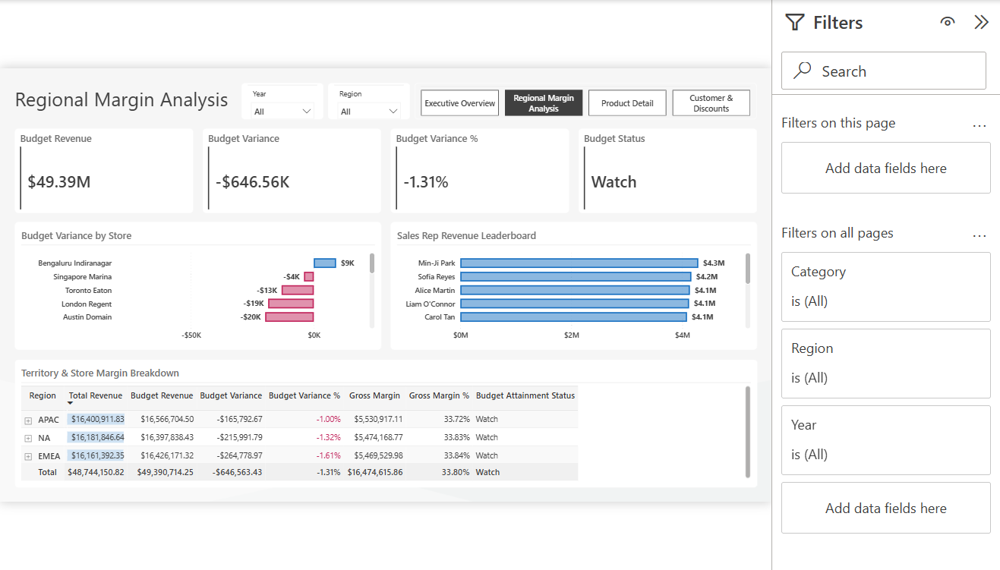
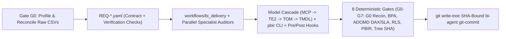

# Autonomous BI Engineering Agent System

**Governed Power BI (`PBIP` / `TMDL` / `PBIR`) engineering & Commercial Finance showcase — `$48.74M` Net Revenue, `$16.47M` Gross Margin (`33.80%`), empirically verified across 8 contract-driven deterministic gates (`G0`–`G7`).**

---

## Business Problem

Commercial Finance leaders require accurate margin-mix visibility, store-level budget accountability, and discount leakage tracking across **$53.12M** Gross Revenue and **$48.74M** Net Revenue (`$16.47M` Gross Margin at `33.80%` GM%, `-$646.56K` Budget Variance across `25,000` sales lines, `12,500` orders, `113,110` units, and `300` active customers).

In practice, conventional BI delivery fails silently through unverified DAX drift, cross-grain store-budget inflation, and multi-fact Row-Level Security (RLS) leaks. This system combines domain-agnostic multi-agent Power BI orchestration (`workflows/bi_delivery`) with an **8-gate verification harness (`G0`–`G7`)**—spanning Gate `G0` messy flat-file profiling and raw-to-staged reconciliation ([ADR-0007](docs/adr/0007-gate-g0-data-profiling-and-domain-agnostic-contracts.md)), runtime PBIR hooks, and Git tree-SHA evidence binding.

---

## Top 3 Quantified Commercial Finance Insights

| Metric | Portfolio Actual (2024–2026) | Metric | Portfolio Actual (2024–2026) |
| :--- | ---: | :--- | ---: |
| **Gross Revenue** | `$53,117,840.90` (`$53.12M`) | **Budget Revenue** | `$49,390,714.25` (`$49.39M`) |
| **Total Discount / Rate** | `$4,373,690.08` (`8.23%`) | **Budget Variance** | `-$646,563.43` (`-1.31%`, *Watch*) |
| **Net Revenue (`Total Revenue`)** | `$48,744,150.82` (`$48.74M`) | **Gross Margin / GM%** | `$16,474,615.86` (`33.80%`) |
| **Total COGS** | `$32,269,534.96` (`$32.27M`) | **AOV / Rev per Customer** | `$3,899.53` / `$162,480.50` |

### 1. Revenue vs. Margin Dilution (`905 bps` Category Spread & SKU Inversion)
- **Category Mix:** `Connected Devices` leads margin at **`37.02%`** (`$3.94M` GM on `$10.65M`), followed by `Accessories` (`35.28%` on `$10.50M`), `Cloud Hardware` (`34.52%` on `$11.80M`), `Managed Services` (`31.55%` on `$9.40M`), and `Enterprise Software` at **`27.97%`** (`$1.79M` on `$6.40M`) — a **`905 bps`** (`9.05 pp`) spread.
- **SKU Margin Inversion:** #1 revenue SKU `Edge Gateways Model 41` (`$1.85M` rev, **`25.39%`** GM, `$470.90K` GM, `8.86%` discount) generates **`$164.08K` less gross profit** than #2 `Docks & Cables Model 37` (`$1.68M` rev, **`37.84%`** GM, `$634.99K` GM).

### 2. Concentrated Store-Level Budget Leakage (`-$646.56K` / `-1.31%`)
- **Regional Drag:** `17` of `18` stores miss budget (only `1` positive at `+$9.05K`); `EMEA` leads the drag at **`-1.61%`** (`-$264.78K` vs. `$16.43M` budget), ahead of `NA` (`-1.32%` / `-$215.99K`) and `APAC` (`-1.00%` / `-$165.79K`).
- **Bottom-5 Concentration (`44.0%` of Net Miss / `-$284.61K`):** `Dubai DIFC` (`-$67.86K`, `-2.51%`), `San Francisco Embarcadero` (`-$59.02K`, `-2.16%`), `Amsterdam Zuid` (`-$55.58K`, `-2.07%`), `Sydney George St` (`-$51.71K`, `-1.86%`), and `Berlin Mitte` (`-$50.43K`, `-1.82%`) — `3` of `5` in `EMEA`.

### 3. Discounting Drag on Net Realization (`$4.37M` = `6.8×` Budget Shortfall)
- **Portfolio Leakage:** An `8.23%` discount rate removes **`$4.37M`** from `$53.12M` Gross Revenue to net `$48.74M` (`Gross - Discount = Net`, diff `0.00`) — **`6.8×`** larger than the global budget variance (`-$646.56K`).
- **Category & Subcategory Drivers:** `Managed Services` is the highest-discounting category (**`8.47%`**, `$870.14K`) while trailing portfolio margin (`31.55%` GM%), led by subcategories `Support Plans` (**`8.60%`**, `$439.31K`) and `Onboarding Packs` (**`8.34%`**, `$430.83K`).

---

## Executive Dashboard Gallery (`REQ-002`)

Live Power BI Desktop renders captured by Gate `G6` (`pbir desktop screenshot --all`) across `4` report pages (`44` visuals):

| Executive Overview | Regional Margin Analysis |
| :---: | :---: |
|  |  |
| *Tracks `$48.74M` Net Revenue vs. `$49.39M` Budget (`-$646.56K`), `33.80%` GM%, and monthly revenue-vs-budget trends.* | *Pinpoints the `-$646.56K` miss to `EMEA` (`-1.61%`) and the bottom-5 stores driving `44.0%` of global variance.* |
| **Product Detail** | **Customer & Discounts** |
|  |  |
| *Surfaces the `905 bps` category GM% spread and the `Edge Gateways Model 41` (`25.39%` GM) SKU margin inversion.* | *Quantifies `$4.37M` (`8.23%`) discount leakage across `300` active customers and top category `Managed Services` (`8.47%`).* |

---

## Architecture & AI/BI Engineering Showcase

### Showcase Scope (`pbi/EnterpriseSales`)
- **Semantic Model:** `8` tables, `7` `1:*` `Single` relationships, `3` hierarchies, `DimDate` date table, `20` documented KPIs across `5` folders, and `4` fail-closed RLS roles (`Region_NA`, `Region_EMEA`, `Region_APAC`, `Dynamic_SalesRep`).
- **PBIR Report:** `4` pages (`44` visuals) authored and validated exclusively via the `pbir` CLI.

### Why This Engineering Matters for Finance
- **Empirical DAX Truth & Latency SLAs (`G4`):** Reconciles `51` ADOMD.NET assertions within `±0.01`—including `[Total Revenue] = [Gross Revenue] - [Total Discount]` accounting tie-outs, cross-grain `BLANK()` budget guards, and actuals-cutoff time intelligence—while enforcing `<= 1500ms` cold / `<= 500ms` warm SLAs.
- **Multi-Fact Fail-Closed RLS (`G1` & `G5`):** `Dynamic_SalesRep` combines UPN filtering on `DimSalesRep` with `tablePermission FactBudget = FALSE ()` so sales reps and unauthorized principals see `0` rows across both `FactSales` and `FactBudget` (with [ADR-0006](docs/adr/0006-customdata-rls-testing-shim-and-service-hardening.md) pre-publish `CUSTOMDATA()` hardening).
- **Strict Tool Cascade & Runtime Guardrails:** `PreToolUse` hooks block direct writes to `*.Report/definition/**/*.json` (enforcing `pbir` CLI exclusively) and block unverified `git commit` invocations.
- **Tamper-Evident Commits & Fault Injection (`G7`):** `bi-agent git-commit` verifies the staged `git write-tree` SHA against `verification-report.json`, backed by `11` fail-closed fault-injection tests (`tests/fault_injection`).
- **Clean Authored IP vs. Vendored Provenance:** Authored verification engine, skills, and PBIP showcase are cleanly isolated from `15` third-party skills tagged `linguist-vendored` in [`.gitattributes`](.gitattributes).

---

## Productionising on Microsoft Fabric

Promoting [`pbi/EnterpriseSales`](pbi/EnterpriseSales/EnterpriseSales.pbip) from local Power BI Desktop verification to Microsoft Fabric production follows a governed four-stage architecture:

- **Git Integration & Parameterized Pipelines:** Bind the Dev workspace to `pbi/EnterpriseSales` (`PBIP`/`TMDL`/`PBIR`) and promote via Deployment Pipelines (`Dev -> Test -> Prod`), swapping local `DataFolder` for stage Lakehouse/Warehouse endpoints.
- **Medallion Data & Headless SPN Gates:** Source Gold Delta tables via Import + Incremental Refresh (`RangeStart`/`RangeEnd`) or Direct Lake, then run headless Entra ID SPN `G3`/`G4`/`G5` verification over the Test XMLA endpoint.
- **Pre-Publish Security & Governance:** Strip `CUSTOMDATA()` precedence per [ADR-0006](docs/adr/0006-customdata-rls-testing-shim-and-service-hardening.md) so `Dynamic_SalesRep` enforces strict `USERPRINCIPALNAME()`, enforce Viewer/App RBAC, Purview sensitivity labels, and post-refresh smoke checks.

Read the complete 1-page architect blueprint: **[Microsoft Fabric Productionisation Blueprint](docs/PRODUCTIONISATION_BLUEPRINT.md)**.

---

## Verification Proof (`REQ-002`)

Latest Passing Verification Report Excerpt (REQ-002 — Live G1–G7 Evidence)

- **Overall Status:** `PASS` | **Git Branch:** `docs/portfolio-executive-polish` | **Artifacts:** `artifacts/runs/REQ-002/verification-report.md`, `artifacts/runs/REQ-002/verification-report.json` (`Staged Tree SHA` locked by final pre-commit `verify-all` prior to `bi-agent git-commit`)

| Gate | Name | Status | Duration (ms) | Summary |
| :--- | :--- | :---: | ---: | :--- |
| G1 | Design Contract | `PASS` | 12 | Validated 2 facts, 5 dims, 20 KPIs, 4 RLS roles |
| G2 | PBIP & TMDL Structure | `PASS` | 1387 | PBIP clean and TE2 loaded 8 table(s) |
| G3 | BPA & VertiPaq Audit | `PASS` | 6184 | BPA errors=0, warnings=0, vpax_ok=True |
| G4 | Live DAX Reconciliation & Perf | `PASS` | 38172 | Reconciled 51 DAX assertion(s) within +/-0.01 |
| G5 | Live RLS Impersonation | `PASS` | 14287 | Verified 7 RLS impersonation scenario(s) with zero leakage |
| G6 | Report QA & Desktop Render | `PASS` | 91061 | pbir validate passed (4 screenshot(s)) |
| G7 | Git Governance & Tree Binding | `PASS` | 162 | Branch `docs/portfolio-executive-polish` bound to staged `git write-tree` SHA |

- **G4 DAX Benchmark Latency vs. SLA:** Cold `avg=7.0ms`, `max_cold_ms=7.0ms` (SLA `<= 1500ms`) | Warm `avg=3.3ms`, `max_warm_ms=4.0ms` (SLA `<= 500ms`) (`artifacts/runs/REQ-002/benchmark_results.csv`)

| Role | Principal | FactSales Rows | FactBudget Rows | Status |
| :--- | :--- | ---: | ---: | :---: |
| Region_NA | (static) | 8,349 | 216 | `PASS` |
| Region_EMEA | (static) | 8,269 | 216 | `PASS` |
| Region_APAC | (static) | 8,382 | 216 | `PASS` |
| Dynamic_SalesRep | `<local_user>` | 0 | 0 | `PASS` |
| Dynamic_SalesRep | `alice.emea@contoso.com` | 2,099 | 0 | `PASS` |
| Dynamic_SalesRep | `bob.na@contoso.com` | 2,051 | 0 | `PASS` |
| Dynamic_SalesRep | `unauthorized.user@contoso.com` | 0 | 0 | `PASS` |

---

## Deep Documentation

| Document | Audience | Contents |
| :--- | :--- | :--- |
| [Fabric Productionisation Blueprint](docs/PRODUCTIONISATION_BLUEPRINT.md) | Cloud / BI Architects | Git Integration, Deployment Pipelines, Medallion Refresh/Direct Lake, SPN XMLA Gates, `ADR-0006` Hardening |
| [Operations, Matrix & CLI Reference](docs/OPERATIONS_AND_CLI.md) | BI Engineers & Reviewers | 8-Gate Matrix (`G0`–`G7`), `pbi/EnterpriseSales` Inventory, Finance Safeguards, CLI, CI & IP Attribution |
| [End-to-End Delivery Walkthrough](docs/WALKTHROUGH.md) | Technical Reviewers | Phase-by-phase build history, empirical live `REQ-002` evidence, and fault-injection design |
| [Architecture Decision Records](docs/adr/README.md) | Engineering Leads | `ADR-0001` through `ADR-0007` covering Gate `G0`, declarative contracts, PBIR CLI exclusivity, and RLS hardening |
| [Master Plan](docs/PLAN.md) | Maintainers | Original 7-gate architecture and 3-window delivery cadence |
| [Phase State Checkpoint](docs/PHASE_STATE.md) | Maintainers & Agents | Concise live status checkpoint (`<= 60` lines) across Phases 1–9 |
