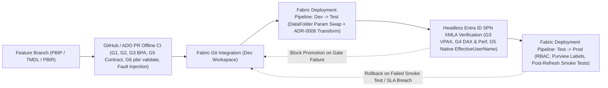

# Microsoft Fabric Productionisation Blueprint (`pbi/EnterpriseSales`)

This blueprint defines the enterprise promotion architecture for taking [`pbi/EnterpriseSales`](../pbi/EnterpriseSales/EnterpriseSales.pbip) from local Power BI Desktop verification (`REQ-002`) into a governed **Microsoft Fabric** production deployment without sacrificing deterministic DAX reconciliation or fail-closed Row-Level Security (RLS).

## End-to-End Promotion & Rollback Architecture

## 1. Fabric Git Integration (`pbi/EnterpriseSales`)

- **Workspace Git Binding:** Connect the **Dev** Fabric Workspace directly to repository subfolder `pbi/EnterpriseSales`, synchronizing the thick `.pbip` project (`EnterpriseSales.SemanticModel` in **TMDL** and `EnterpriseSales.Report` in **PBIR**).
- **Zero Binary Merges:** All model, DAX, RLS, and visual layout changes are reviewed as plain-text TMDL/PBIR diffs in pull requests and validated by offline CI before syncing into Dev.
- **Branch Governance:** Restrict production promotion exclusively to `main`; Dev workspace syncs only from merged PRs or isolated feature branches during engineering spikes.

## 2. Fabric Deployment Pipelines (`Dev -> Test -> Prod`) & Parameter Swap

Promote `EnterpriseSales.SemanticModel` and `EnterpriseSales.Report` across **Dev → Test → Prod** using Fabric Deployment Pipelines with automated parameter rules:

| Environment | Source Parameter (`expressions.tmdl`) | Target Binding | Governance Rule |
| :--- | :--- | :--- | :--- |
| **Local / CI** | `DataFolder` | `data/raw` CSVs | Deterministic ground-truth validation (`seed: 42`) |
| **Fabric Dev** | `LakehouseEndpoint` / `SqlEndpoint` | `lh_enterprise_sales_dev` | `Environment = "Dev"`, `ADR-0006` dev shim allowed |
| **Fabric Test** | `LakehouseEndpoint` / `SqlEndpoint` | `lh_enterprise_sales_test` | `Environment = "Test"`, `ADR-0006` transform + SPN XMLA |
| **Fabric Prod** | `LakehouseEndpoint` / `SqlEndpoint` | `lh_enterprise_sales_prod` | `Environment = "Prod"`, strict `USERPRINCIPALNAME()` RLS |

- **Power Query Parameter Swap:** Define stage-scoped Power Query parameters (`LakehouseEndpoint`, `SqlEndpoint`, `Environment`) replacing the local [`DataFolder`](../pbi/EnterpriseSales/EnterpriseSales.SemanticModel/definition/expressions.tmdl) parameter while keeping downstream M transformations identical across stages.
- **Deterministic Rollback:** Because every release is bound to an immutable `git write-tree` SHA (`G7`), rollback reverts Dev to the last verified Git tag and re-promotes through the deployment pipeline without manual workspace edits.

## 3. Medallion Fabric Lakehouse / Warehouse & Refresh Strategy

Source all `Dim*` (`DimDate`, `DimProduct`, `DimStore`, `DimCustomer`, `DimSalesRep`) and `Fact*` (`FactSales`, `FactBudget`) tables from curated **Gold** Delta tables (`Bronze -> Silver -> Gold`):

- **Option A — Import + Incremental Refresh (Recommended for Predictable BI SLAs):**
  - Define `RangeStart` and `RangeEnd` DateTime Power Query parameters on `FactSales` (and `FactBudget` if historical revisions occur) with `DateKey`-aligned query folding against the Fabric Lakehouse SQL Analytics Endpoint or Warehouse.
  - Enable **Detect Data Changes** using a Gold watermark column (`UpdatedAtUtc`) so closed historical partitions remain frozen while only active partitions refresh.
- **Option B — Direct Lake on OneLake Delta (Low-Latency Scale):**
  - Bind semantic model partitions directly to Gold OneLake Delta Parquet tables for near-zero-latency updates without Import memory duplication.
  - Configure DirectQuery fallback governance and VertiPaq framing checks to prevent unexpected fallback latency spikes on wide DAX scans.

## 4. Headless Entra ID SPN Verification (Test XMLA Endpoint)

Before promoting **Test → Prod**, an Entra ID Service Principal (SPN) authenticates headlessly against the Test Workspace XMLA Read/Write endpoint (`powerbi://api.powerbi.com/v1.0/myorg/<TestWorkspace>`) to run the live verification split documented in [ADR-0005](adr/0005-offline-ci-versus-live-desktop-verification-split.md):

1. **Gate `G3` (`dscmd vpax`):** Export VertiPaq Analyzer telemetry over XMLA to verify column cardinality, dictionary footprint, and relationship integrity at production data scale.
2. **Gate `G4` (ADOMD.NET + `dscmd benchmark`):** Execute all `51` ground-truth and finance edge-case DAX assertions (accounting tie-out, cross-grain `BLANK()`, `"No Actuals"`) within `±0.01` and enforce cold (`<= 1500 ms`) and warm (`<= 500 ms`) latency SLAs.
3. **Gate `G5` (Native `EffectiveUserName`):** Run impersonated ADOMD.NET queries over XMLA using dedicated Entra ID test principals for `Region_NA`, `Region_EMEA`, `Region_APAC`, `Dynamic_SalesRep`, and an unmapped UPN (`0` rows on both `FactSales` and `FactBudget`).

## 5. `ADR-0006` Security Hardening, Governance & Post-Refresh Smoke Tests

- **Mandatory `ADR-0006` Pre-Publish Transform:** Strip `CUSTOMDATA()` precedence from `Dynamic_SalesRep` prior to Test/Prod deployment per [ADR-0006](adr/0006-customdata-rls-testing-shim-and-service-hardening.md):
  - Production `DimSalesRep` expression: `'DimSalesRep'[UserPrincipalName] = USERPRINCIPALNAME ()`
  - Retained cross-fact deny expression: `tablePermission FactBudget = FALSE ()`
  - Closing `CUSTOMDATA()` prevents any Read/Build user connecting via XMLA or **Analyze in Excel** from spoofing another sales representative's UPN.
- **Workspace RBAC Separation:** Grant end users **Viewer** workspace access or distribute via **Power BI App** audiences only—never Contributor, Member, or Admin, which bypass RLS—while isolating publish permissions to the CI/CD SPN.
- **Microsoft Purview Sensitivity Labels & Lineage:** Enforce `Confidential — Finance` sensitivity labels at the Gold Lakehouse and Semantic Model layers with automatic downstream inheritance to `EnterpriseSales.Report` and Excel exports, tracked end-to-end in Fabric Lineage and Purview Data Map.

### Stage Promotion, Smoke Tests & Rollback Checklist

| Stage | Trigger | Automated Check / Transform | Failure Action |
| :--- | :--- | :--- | :--- |
| **PR / Merge** | GitHub / ADO PR | `ruff`, `pytest` (unit + 9 FI), `verify-all --offline` (`G1`, `G2`, `G3` BPA, `G5` contract, `G6` `pbir validate`) | Block PR merge |
| **Dev → Test** | Pipeline Promote | Swap `DataFolder` -> `Test` endpoint; apply `ADR-0006` `USERPRINCIPALNAME()` transform | Abort promotion |
| **Test Validation** | Post-Deploy SPN | XMLA `G3` VPAX + `G4` `51` DAX & cold/warm SLAs + `G5` native `EffectiveUserName` | Block Prod deploy |
| **Prod Post-Refresh** | Refresh Webhook | Smoke test: fact row-count floors, Gross − Discount = Net identity, unmapped UPN `0` rows | Alert + Rollback tag |

- **Post-Refresh Smoke Test Contract:** Every scheduled or pipeline refresh executes a lightweight SPN XMLA probe asserting non-zero fact partitions, accounting reconciliation (`ABS([Total Revenue] - ([Gross Revenue] - [Total Discount])) <= 0.01`), and `0`-row fail-closed RLS enforcement on an unmapped service test identity.
- **Rollback Execution:** On any failed Prod smoke test or SLA regression, pin Dev Git Integration back to the previous passing commit SHA (`git tag`), re-sync Dev, and promote through `Test -> Prod` while retaining full audit traceability in `verification-report.json`.

## Related References

- [Executive Overview & Showcase](../README.md)
- [Operations, 7-Gate Matrix & CLI Reference](OPERATIONS_AND_CLI.md)
- [ADR-0005: Offline CI vs. Live Desktop Verification Split](adr/0005-offline-ci-versus-live-desktop-verification-split.md)
- [ADR-0006: CUSTOMDATA() RLS Testing Shim & Service Hardening](adr/0006-customdata-rls-testing-shim-and-service-hardening.md)
